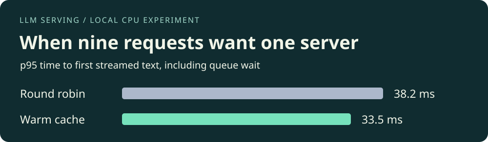
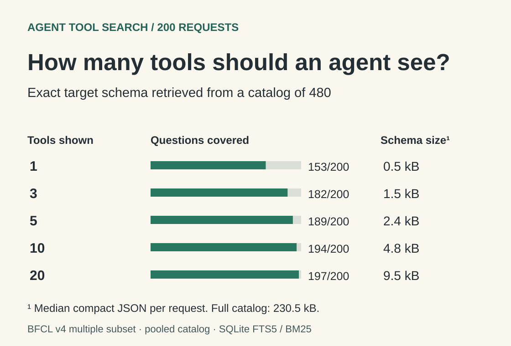

# Experiments

I run small ML and systems experiments to find out where an engineering decision changes the result. Each entry links to the implementation and the measurements behind it.

In this burst test, nine of twelve requests shared a prefix. Sending them to the same warm replica increased p95 queue wait from 32.2 to 32.8 ms, yet first text arrived sooner. I timed 288 requests per policy on four CPU replicas. [Method](techpulse-benchmarks/nov24-routing/SERVING.md) · [Request timings](techpulse-benchmarks/nov24-routing/local-serving.json)

## Can the agent see the tool it needs?

On 200 BFCL questions, doubling the shortlist from five tools to ten recovered five exact target schemas. Six targets were still missing at ten. [Method and raw ranks](techpulse-benchmarks/tool-shortlist/)

## Agent decisions and retrieval

| Engineering question | Implementation | Evidence |
|---|---|---|
| Will a local function-calling model change a device when I only ask a question? | [FunctionGemma evaluation](techpulse-benchmarks/nov26-tool-choice/bench.py) | [Prompt-level responses](techpulse-benchmarks/nov26-tool-choice/results.json) |
| Is it worth reranking 50 SciFact candidates instead of 10? | [Reranker](techpulse-benchmarks/nov23-retrieval/rerank.py) | [Ranking and latency results](techpulse-benchmarks/nov23-retrieval/rerank-results.json.gz) |
| How do output constraints affect generation? | [Constraint experiment](techpulse-benchmarks/nov24-constraints/experiment.mjs) | [Results](techpulse-benchmarks/nov24-constraints/results.json) |

## Would I ship the 4-bit SQL model?

Both formats passed the same **2 of 10** SQL tasks. On the per-shop maximum task, both returned a single row for the whole table. Q4_K_M used **629 MiB** peak process memory versus **809 MiB** for Q8_0. I would change the model before spending more memory on precision for this workload.

[GPU experiment and method](techpulse-benchmarks/nov26-quant/) · [Generated queries and fixture results](techpulse-benchmarks/nov26-quant/results.json)

## Inference and storage

| Engineering question | Implementation | Evidence |
|---|---|---|
| Does a tokenizer upgrade preserve the IDs for the same Python code? | [GPT-2 tokenizer comparison](techpulse-benchmarks/nov26-tokenizers/bench.py) | [Timings and ID hashes](techpulse-benchmarks/nov26-tokenizers/measured.jsonl) |
| What does one more SQLite index column cost on writes? | [Insert benchmark](techpulse-benchmarks/nov22-sqlite/inserts.py) | [Insert timings](techpulse-benchmarks/nov22-sqlite/insert-results.json) · [Read and storage results](techpulse-benchmarks/nov22-sqlite/results.json) |
| Could I reproduce the Qdrant nested-filter speedup? | [Nested-filter benchmark](techpulse-benchmarks/nov22/nested.py) | [Recorded runs](techpulse-benchmarks/nov22/) |

[Browse all experiments](techpulse-benchmarks/) · [License](LICENSE)
