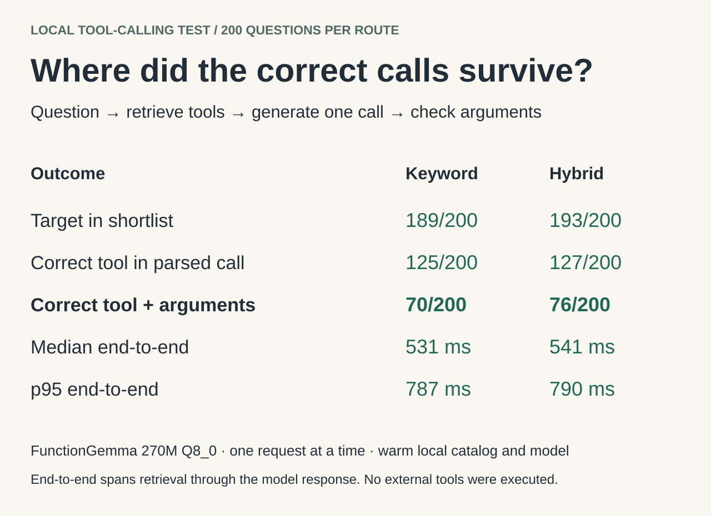

# From a five-tool shortlist to a correct call

Question → retrieve tool schemas → render prompt → FunctionGemma proposes a call → validate function and arguments.

The design decision is whether to insert a CPU embedding step before the same local caller. Keyword search returns up to five BM25 matches. Hybrid reserves up to three keyword matches and fills to five with distinct MiniLM matches. The corpus, exact schema identities, and labels are identical to the [retrieval experiment](HYBRID.md). Every shortlist target rank is checked against that experiment.

I used llama.cpp b12668 with the ggml-org/functiongemma-270m-it-GGUF Q8_0 weights at revision 2566ce14aedfc14fdd0de955ba67346425e67126. Each prompt exposes only its own shortlist. Dotted function names are reversibly aliased, and benchmark-specific parameter types are translated to standard JSON Schema names where supported. Temperature is zero, seed 42, max output 192 tokens, no tools connected. The server uses one slot, 8192 context, prompt caching requested off, no conversation history. This is the base instruction-tuned model without benchmark-specific fine-tuning.

The grader requires a single complete call mapped to the exact offered schema and the expected argument values. Extra arguments fail. An omitted argument passes if its reference alternatives include an empty string. Strings are compared exactly, lists in order, numeric values by equality, and booleans distinctly. The primary metric counts the whole call. This is a custom strict grader, not the official BFCL leaderboard metric. The test does not execute functions or measure answer quality after a function returns.

There is one timed run per question per route. Question order is seeded and shuffled, route order alternates by question. End-to-end timing starts before retrieval, includes schema serialization, local HTTP, prefill and full generation, and stops once the response is decoded. The validator runs outside the timer. Model loading, catalog construction, and one warmup are excluded. Timings describe a single sequential client, without concurrent queueing.

To reproduce, restore the files and packages in [SEMANTIC.md](SEMANTIC.md). Start llama-server on port 18974 with --jinja -ngl 99 -np 1 -c 8192 --cache-ram 0. Run python calls.py INPUT_DIR then python call_chart.py from this directory with Pillow installed on macOS.

Hybrid exposed five targets keyword search missed and displaced one. None of those six questions produced a correct full call on either route. On questions where both routes exposed the target, 13 calls improved and seven regressed. The currency converter appeared fifth under hybrid, but FunctionGemma replied in prose without calling it. End-to-end medians were 531 ms (keyword) and 541 ms (hybrid); p95 was 787 and 790 ms. These are observed timings from one paired run per question.

[All 400 model responses and timings](call-results.json)
