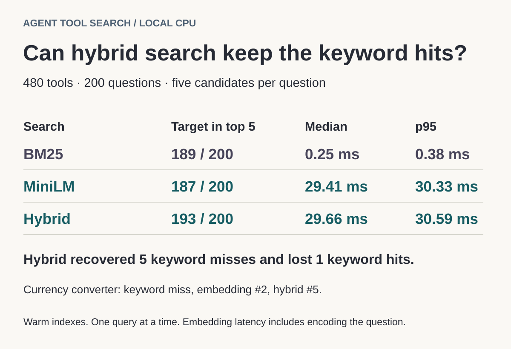

# Five slots for 480 tools

I kept the top three BM25 matches and filled the remaining slots with MiniLM results in rank order, skipping duplicates. If keyword search returned fewer than three results, embeddings filled every open slot. The rule was fixed before running it, without tuning against the results. Every hybrid response contained exactly five distinct schemas.

This run repeats both baselines on the [same pinned inputs and environment](SEMANTIC.md). Run python hybrid.py TEMP_DIR alongside results.json and semantic-results.json. It checks every baseline's top-five target rank against the preceding experiments. The hybrid is executed sequentially with fresh question embeddings. All three methods are timed independently in rotating order on three shuffled passes. Index building and label checking are outside the timer. Medians and p95 in the chart use 600 warm searches per method. Each question counts once toward retrieval coverage. A hit means the exact labeled tool appears; tool execution and downstream answer quality are outside the evaluation.

[Paired ranks and latencies](hybrid-results.json)
