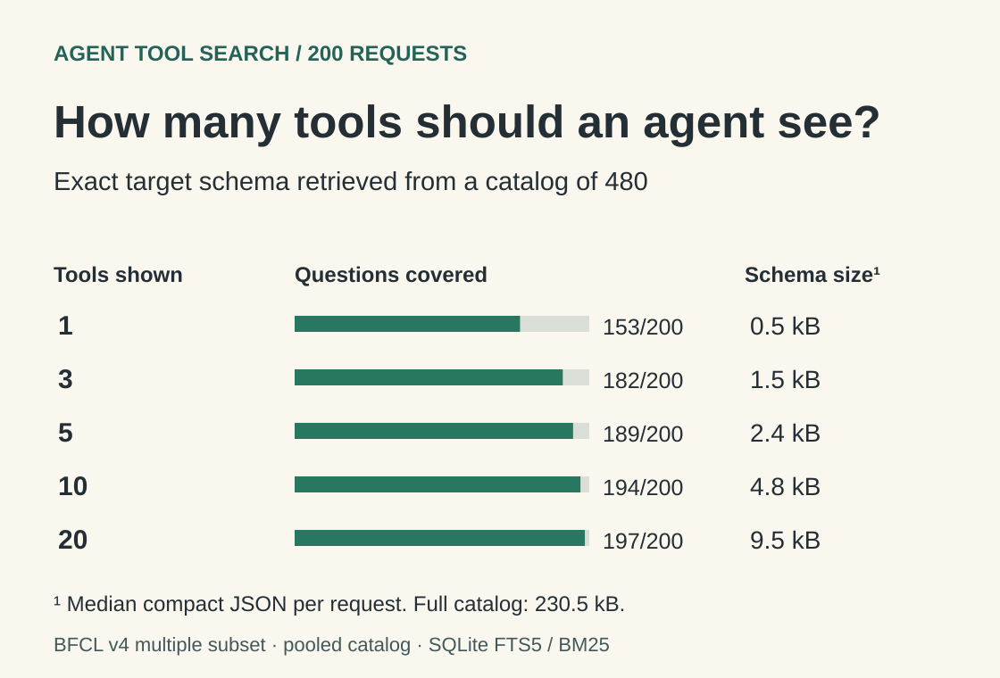

# Can the agent see the tool it needs?

I pooled every distinct canonical function schema from BFCL v4’s multiple subset into a single 480-schema catalog. I ran SQLite FTS5 BM25 locally over the tool name, description, and parameter names, using the user question as the query. Each question has one labeled function in its original menu. The metric is whether that exact schema appears in the retrieved set. A different schema that could also satisfy the request receives no credit. This is a custom retrieval experiment, not an official BFCL score.

Download BFCL_v4_multiple.json and possible_answer/BFCL_v4_multiple.json from the [pinned dataset directory](https://github.com/ShishirPatil/gorilla/tree/6ea57973c7a6097fd7c5915698c54c17c5b1b6c8/berkeley-function-call-leaderboard/bfcl_eval/data). Run python3 bench.py CASES LABELS, then python3 render.py. The benchmark saves the rank and serialized byte count for each request. Byte counts exclude system prompts and transport envelopes. No LLM was called.

[Raw ranks and byte counts](results.json)
